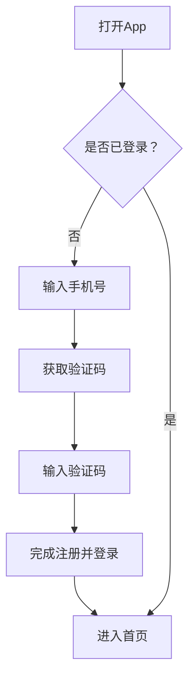
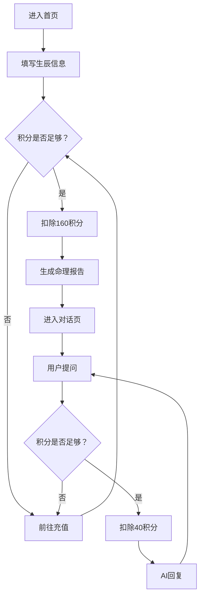

# 命理Agent产品需求文档（PRD）

## 1. Product Overview
命理Agent是一款基于传统子平八字命理与西方占星术的智能命理分析应用，通过输入出生信息进行深度命理星盘计算，为用户提供个性化的运势解读和人生指引。产品采用移动端优先设计，支持多生辰管理、积分付费体系和手机验证码登录。

- **核心价值**：结合传统命理与现代心理学，为用户提供专业、全面的命理分析报告
- **目标用户**：对命理感兴趣的移动端用户，年龄18-50岁

## 2. Core Features

### 2.1 User Roles
| Role | Registration Method | Core Permissions |
|------|---------------------|------------------|
| 普通用户 | 手机验证码注册/登录 | 使用命理推算、管理生辰、充值积分 |

### 2.2 Feature Module
1. **登录/注册页**：手机验证码登录与注册
2. **首页（添加生辰）**：输入生辰信息、省市级联选择、公历/农历切换
3. **对话页**：AI流式回复、自由提问
4. **人物列表页**：管理已添加的生辰
5. **充值页**：积分充值、微信/支付宝支付
6. **个人中心**：积分查询、交易记录

### 2.3 Page Details
| Page Name | Module Name | Feature description |
|-----------|-------------|---------------------|
| 登录/注册页 | 手机号输入 | 输入手机号，获取验证码 |
| 登录/注册页 | 验证码输入 | 输入6位验证码完成登录 |
| 首页 | 生辰表单 | 姓名、性别、公历/农历切换、年月日时分选择、省市级联选择 |
| 首页 | 积分显示 | 显示当前积分余额 |
| 对话页 | AI回复 | 流式输出AI命理解读报告 |
| 对话页 | 提问输入 | 用户自由提问，每次扣除40积分 |
| 人物列表页 | 人物管理 | 查看、删除已添加的生辰 |
| 充值页 | 充值档位 | 40/80/120/160/200积分档位选择 |
| 充值页 | 支付方式 | 微信支付、支付宝支付 |
| 个人中心 | 积分信息 | 当前积分、交易记录 |

## 3. Core Process

### 用户注册登录流程

### 命理推算流程

## 4. User Interface Design

### 4.1 Design Style
- **主色调**：渐变紫蓝色系（#6366f1 - #8b5cf6），体现神秘、专业感
- **辅助色**：金色（#fbbf24）用于积分、重点提示
- **按钮风格**：圆角矩形、渐变背景、hover动效
- **字体**：Noto Sans SC 中文字体
- **布局风格**：卡片式布局，移动端优先
- **图标**：lucide-react图标库

### 4.2 Page Design Overview
| Page Name | Module Name | UI Elements |
|-----------|-------------|-------------|
| 登录/注册页 | 输入区域 | 简洁卡片式输入框，渐变背景 |
| 首页 | 生辰表单 | 表单式布局，省市级联选择器 |
| 对话页 | 消息区域 | 气泡式消息，Markdown渲染 |
| 充值页 | 充值档位 | 网格卡片选择，支付方式切换 |

### 4.3 Responsiveness
- **移动端优先**：针对手机屏幕优化，触控友好
- **桌面端适配**：响应式布局，最大宽度限制

### 4.4 特殊交互
- **省市级联选择**：选择省份后自动更新城市列表
- **日期联动**：根据年份月份自动计算可选天数
- **AI流式回复**：打字机效果输出命理报告
