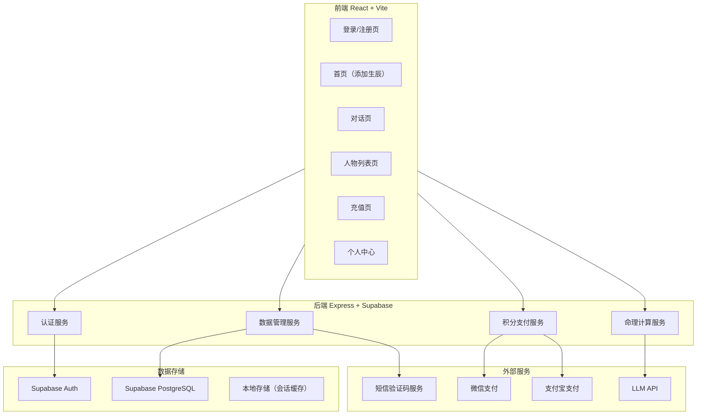
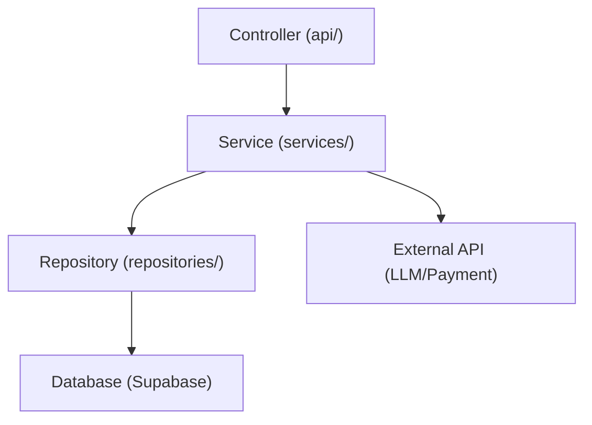
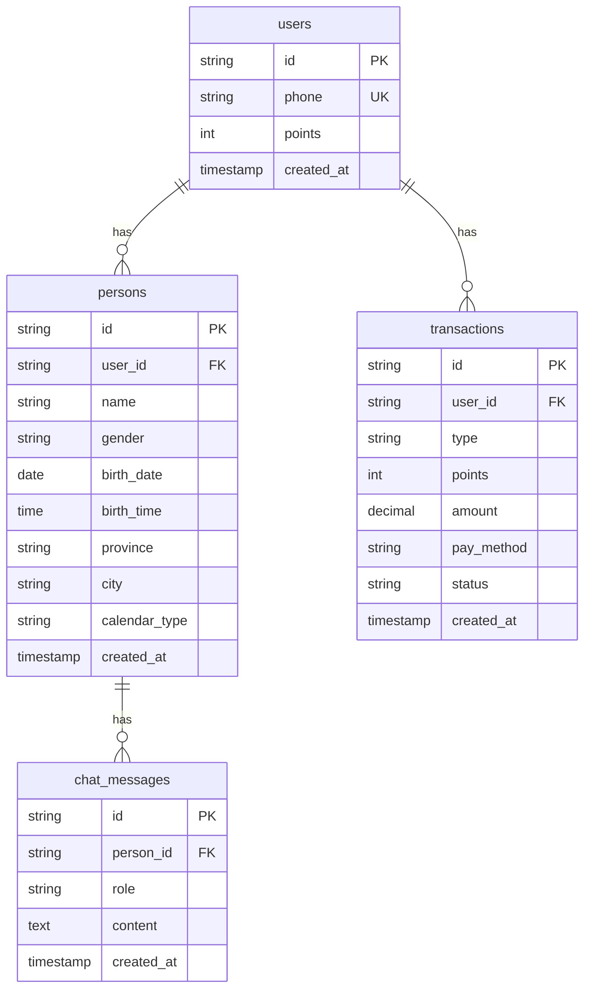

# 命理Agent技术架构文档

## 1. Architecture Design


## 2. Technology Description
- **前端**：React@18 + TypeScript + TailwindCSS@3 + Vite@7
- **状态管理**：Zustand
- **路由**：React Router DOM v6
- **后端**：Express@4 + TypeScript
- **数据库**：Supabase PostgreSQL
- **认证**：Supabase Auth + 短信验证码
- **支付**：微信支付、支付宝支付
- **LLM**：OpenAI API (GPT-4o)

## 3. Route Definitions
| Route | Purpose |
|-------|---------|
| / | 首页（添加生辰） |
| /login | 登录/注册页 |
| /chat/:personId | 对话页 |
| /persons | 人物列表页 |
| /recharge | 充值页 |
| /profile | 个人中心 |

## 4. API Definitions

### 4.1 认证接口
| Method | Path | Description |
|--------|------|-------------|
| POST | /api/auth/sms | 发送验证码 |
| POST | /api/auth/verify | 验证验证码并登录 |
| GET | /api/auth/me | 获取当前用户信息 |

### 4.2 人物接口
| Method | Path | Description |
|--------|------|-------------|
| POST | /api/persons | 创建人物（扣除积分） |
| GET | /api/persons | 获取人物列表 |
| GET | /api/persons/:id | 获取人物详情 |
| DELETE | /api/persons/:id | 删除人物 |

### 4.3 对话接口
| Method | Path | Description |
|--------|------|-------------|
| GET | /api/chat/messages/:personId | 获取消息历史 |
| POST | /api/chat/send/:personId | 发送消息（流式回复） |
| POST | /api/chat/first/:personId | 生成首次解读 |

### 4.4 支付接口
| Method | Path | Description |
|--------|------|-------------|
| POST | /api/payment/order | 创建充值订单 |
| POST | /api/payment/callback | 支付回调 |
| GET | /api/payment/transactions | 获取交易记录 |
| GET | /api/user/points | 获取当前积分 |

### 4.5 类型定义
```typescript
interface User {
  id: string
  phone: string
  points: number
  created_at: string
}

interface Person {
  id: string
  user_id: string
  name: string
  gender: 'male' | 'female'
  birth_date: string
  birth_time: string
  province: string
  city: string
  calendar_type: 'solar' | 'lunar'
  created_at: string
}

interface ChatMessage {
  id: string
  person_id: string
  role: 'user' | 'assistant'
  content: string
  created_at: string
}

interface Transaction {
  id: string
  user_id: string
  type: 'recharge' | 'consume' | 'refund'
  points: number
  amount: number
  pay_method: string
  status: 'pending' | 'paid' | 'failed'
  created_at: string
}
```

## 5. Server Architecture Diagram


## 6. Data Model

### 6.1 Data Model Definition


### 6.2 Data Definition Language
```sql
-- users table
CREATE TABLE users (
  id UUID PRIMARY KEY DEFAULT gen_random_uuid(),
  phone TEXT UNIQUE NOT NULL,
  points INT DEFAULT 200,
  created_at TIMESTAMP DEFAULT NOW()
);

-- persons table
CREATE TABLE persons (
  id UUID PRIMARY KEY DEFAULT gen_random_uuid(),
  user_id UUID REFERENCES users(id),
  name TEXT NOT NULL,
  gender TEXT NOT NULL CHECK (gender IN ('male', 'female')),
  birth_date DATE NOT NULL,
  birth_time TIME NOT NULL,
  province TEXT NOT NULL,
  city TEXT NOT NULL,
  calendar_type TEXT NOT NULL CHECK (calendar_type IN ('solar', 'lunar')),
  created_at TIMESTAMP DEFAULT NOW()
);

-- chat_messages table
CREATE TABLE chat_messages (
  id UUID PRIMARY KEY DEFAULT gen_random_uuid(),
  person_id UUID REFERENCES persons(id),
  role TEXT NOT NULL CHECK (role IN ('user', 'assistant')),
  content TEXT NOT NULL,
  created_at TIMESTAMP DEFAULT NOW()
);

-- transactions table
CREATE TABLE transactions (
  id UUID PRIMARY KEY DEFAULT gen_random_uuid(),
  user_id UUID REFERENCES users(id),
  type TEXT NOT NULL CHECK (type IN ('recharge', 'consume', 'refund')),
  points INT NOT NULL,
  amount DECIMAL(10,2),
  pay_method TEXT CHECK (pay_method IN ('wechat', 'alipay')),
  status TEXT NOT NULL CHECK (status IN ('pending', 'paid', 'failed')),
  created_at TIMESTAMP DEFAULT NOW()
);

-- indexes
CREATE INDEX idx_persons_user_id ON persons(user_id);
CREATE INDEX idx_chat_messages_person_id ON chat_messages(person_id);
CREATE INDEX idx_transactions_user_id ON transactions(user_id);
```

## 7. 命理计算规则

### 7.1 八字排盘规则
- **年柱**：根据出生年份计算天干地支（甲子纪年法）
- **月柱**：根据出生月份和节气计算天干地支
- **日柱**：根据出生年月日计算天干地支
- **时柱**：根据出生时辰计算天干地支

### 7.2 五行分析规则
- 天干五行：甲乙木、丙丁火、戊己土、庚辛金、壬癸水
- 地支五行：子亥水、寅卯木、巳午火、申酉金、辰戌丑未土
- 五行生克：金克木、木克土、土克水、水克火、火克金

### 7.3 十神规则
- 根据日主与其他天干的关系确定十神（比肩、劫财、食神、伤官、偏财、正财、七杀、正官、偏印、正印）

### 7.4 调候规则
- 冬季出生：需火调候
- 夏季出生：需水调候
- 春季出生：需水滋润
- 秋季出生：需火锻炼

### 7.5 合冲刑害规则
- 六合：子丑合、寅亥合、卯戌合、辰酉合、巳申合、午未合
- 三合：申子辰合水、亥卯未合木、寅午戌合火、巳酉丑合金
- 相冲：子午冲、丑未冲、寅申冲、卯酉冲、辰戌冲、巳亥冲

## 8. 积分计费规则

### 8.1 积分消费
- **首次生成整体运势**：扣除160积分
- **每次追问**：扣除40积分

### 8.2 积分充值
- 40积分 = 4元
- 80积分 = 8元
- 120积分 = 12元
- 160积分 = 16元
- 200积分 = 20元

### 8.3 积分兑换比例
- 1元 = 10积分
