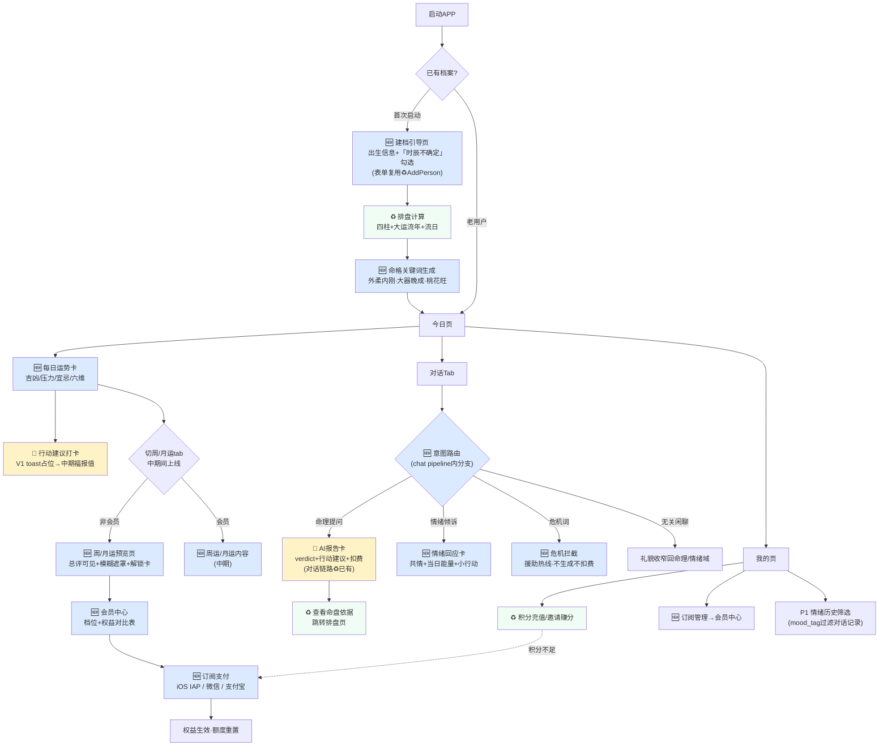

# 趣算算 APP V1.0 需求文档（近期阶段）

> 版本：V1.3 近期阶段（0-3月）｜ 日期：2026-09-24（V1.1 情绪树洞→V1.3并入对话agent；V1.2 运势时间阶梯）
> 范围：订阅会员 + AI对话扣费（含情绪模式agent） + 每日运势 + APP前端（RN）
> **运势时间阶梯（整体结构主线）**：日运(V1·免费钩子) → 周运/月运(中期·会员解锁·续费理由) → 年运/人生报告(中期·按次/会员免费·深度付费)——贯穿本文档3/4/5/6/7/8/9各节，规则见6.5
> 中长期（改命闭环/社区/AI垂类模型/多体系扩展）见整体规划，本文档不含（多体系触发条件见十·P2观察项）

---

## 一、产品背景与目标

**背景**：基于测测/准准/好准竞品调研。测测日活100万靠"每日心情分+AI对话"破命理低频；变现靠会员订阅（25/月、178/年）+ 单项解锁；3·15因达人连麦+虚拟币模糊定价翻车。

**目标**（近期）：
1. **变现地基**：跑通订阅会员 + AI对话扣费闭环（订阅送额度→消耗→复购）
2. **日活抓手**：每日运势独立入口（日级流日+宜忌+压力+行动建议），解决"用户来不来"
3. **情绪留存**：对话内情绪模式（用户在对话里倾诉情绪时，意图路由自动切换"情绪回应"：共情接住+当日流日视角+一个小行动），倾诉门槛低于独立树洞页，与每日运势构成"白天算运、晚上倾诉"双钩子。**合规底线：结构化回应即收口，不做人设、不无限陪聊**（《人工智能拟人化互动服务管理暂行办法》2026-07-15已施行，详见6.4）
4. **会员价值锚**：运势时间阶梯（日/周/月/年/人生）——免费日运拉人，周运/月运给订阅"每月都有新内容"的续费理由，年运/人生报告按次赚深钱（准了39元/月会员的定价逻辑，详见6.5）

**差异化**（中期铺垫）：日行一善打卡+改命可视化，了凡四训"命由我作"，竞品全空白。近期V1做行动建议展示+打卡占位，闭环放中期。

**避坑**：不做达人连麦；明码人民币禁虚拟币模糊定价；文案用"能量/宜忌/体质"非"算命吉凶"降合规风险。

---

## 二、目标用户

- 命理兴趣用户，关注八字/运势/自我成长，女性为主
- 人生过渡期（考研/求职/婚恋/换岗）情绪需求强
- 有付费意愿，偏好订阅制而非按次咨询

---

## 三、功能清单与优先级

| 模块 | 功能 | 优先级 | 说明 |
|---|---|---|---|
| 订阅会员 | 月/季/年订阅 + 首月特惠 | P0 | 变现地基 |
| 订阅会员 | 权益校验（对话额度/运势/报告解锁） | P0 | |
| AI对话 | 命理问答 + 扣费（会员额度/非会员扣分） | P0 | 留存+变现 |
| AI对话 | 档案切换 + 额度展示 | P0 | |
| 每日运势 | 日级流日（吉凶/宜忌/压力/行动建议） | P0 | 日活抓手 |
| 每日运势 | 当日缓存 | P0 | 省LLM成本 |
| 对话·情绪模式 | 意图路由（危机拦截→命理问答/情绪倾诉/闲聊收窄） | P0 | **情绪留存核心**：树洞并入对话，倾诉零门槛 |
| 对话·情绪模式 | 情绪回应卡（共情+当日能量+小行动，结构化即收口） | P0 | 非自由陪聊，控合规控成本 |
| 对话·情绪模式 | 危机关键词拦截 + 心理援助信息 | P0 | 合规刚需，不可裁剪 |
| 对话·情绪模式 | 情绪消息标记(mood_tag) + 历史筛选回顾 | P1 | 复用对话记录，不建独立页 |
| 积分 | 充值/流水/邀请赚取 | P0 | 复用现有 |
| 档案管理 | 出生信息维护 + 多档案 | P0 | 复用现有 |
| 日行一善 | 行动建议展示 + 打卡按钮占位 | P1 | 中期接福报值，**情绪模式利他型小行动并入同一行动体系** |
| 本周运势 | 7天压力曲线 + 日历 | P1 | 中期，周运的基础展示 |
| 运势阶梯 | 周运（7天流日聚合+周主题+关键日） | P1 | 中期，**会员解锁**，周中回访钩子 |
| 运势阶梯 | 月运（流月+关键日提醒） | P1 | 中期，**会员解锁**，月初仪式感（付费墙参考F18） |
| 运势阶梯 | 年运报告（流年深度解读） | P1 | 中期，会员免费/非会员按次，立春主推 |
| 运势阶梯 | 报告中心（年运+人生报告聚合货架） | P1 | 中期，货架形态参考F12 |

---

## 四、信息架构（底部3 Tab）

```
┌─────────────────────────────────────┐
│                                     │
│           （页面内容区）              │
│                                     │
├──────────┬──────────┬───────────────┤
│  今日     │  对话     │     我的       │
│  Daily   │  Chat    │    Profile    │
└──────────┴──────────┴───────────────┘
```

- **今日**（默认Tab）：运势卡（日/周/月时间切换，周/月中期间上线带🔒）+ 行动建议（情绪倾诉统一走对话Tab情绪模式，无独立树洞页）
- **对话**：AI命理问答 + 情绪模式（意图路由自动切换，见5.6）
- **我的**：档案/会员/积分/设置

会员中心、订阅支付、档案编辑等为二级页（push进入）。**报告中心（中期）**：从我的页进入，聚合年运+人生深度报告——运势阶梯的顶点货架。

### 4.1 用户行为全流程图（功能×流程串联）

> 图例：🆕=V1全新开发 ｜ ♻️=复用现有能力 ｜ 🔶=现有能力扩展。开发排期时按图索骥：先做 ♻️ 打底的链路（建档→排盘），再叠 🆕 功能。



**节点清单（开发视角）**：

| 节点 | 状态 | 对应章节 | 说明 |
|---|---|---|---|
| 建档引导页 | 🆕（表单♻️） | 5.2.1补进点4 | AddPerson.tsx改造+时辰勾选 |
| 排盘计算/命盘页 | ♻️ | 现有能力 | dayun_liunian等skill已有 |
| 命格关键词 | 🆕 | F15吸收项 | 排盘数据+LLM，零新算法 |
| 每日运势卡/六维 | 🆕 | 5.1/6.3 | liuri_skill+daily_fortune_service |
| 行动建议打卡 | 🔶 | 5.1 | V1占位，中期接福报值 |
| 周/月运+订阅引导 | 🆕（中期） | 6.5 | period_fortune_service |
| 会员中心/订阅支付 | 🆕 | 5.4/5.5 | subscription模型+IAP |
| 意图路由 | 🆕 | 5.6/6.4 | intent_router（危机词→分类） |
| AI报告卡 | 🔶（链路♻️） | 5.2 | chat.py已有，加行动建议区块 |
| 情绪回应卡 | 🆕 | 5.6/6.4 | mood_response_service |
| 积分充值/邀请 | ♻️ | 现有能力 | transaction链路已有 |
| 情绪历史筛选 | 🆕（P1） | 7.6 | mood_tag过滤 |

---

## 五、页面设计（排版详述）

### 5.1 今日页（首页/默认Tab）

```
┌─────────────────────────────┐
│ 早安，小玲    9月23日 周三  🔔 │  顶栏：问候+日期农历+通知
│                  农历八月十四 │
├─────────────────────────────┤
│ 〔日〕〔周🔒〕〔月🔒〕         │  时间维度切换(周/月中期间)
│  今日小吉          辛金日主   │  运势总览卡（主视觉）
│  〔吉〕                      │   - 吉凶等级大字
│  压力指数 ▓▓▓░░░ 45           │   - 压力指数进度条(0-100)
│  日柱 辛亥 食神               │   - 日干支+十神标签
├─────────────────────────────┤
│ 宜 〔见贵〕〔谈事〕〔学习〕    │  宜忌卡
│ 忌 〔远行〕〔动土〕           │   - 宜=绿色标签 / 忌=红色标签
├─────────────────────────────┤
│ 今日修行                      │  行动建议卡（差异化）
│ 今天建议忍住一次反驳，         │   - 日行一善建议文案
│ 金气收敛，养气之举。           │   - 命理化理由
│ ┌──────────┐                 │   - 打卡按钮(V1占位/中期+福报值)
│ │  ✓ 打卡   │                 │
│ └──────────┘                 │
├─────────────────────────────┤
│ 近期压力                      │  近期压力卡
│ ▁▂▃▁▄▅▆▅ (7日迷你曲线)        │   - 本周7天迷你曲线
│ 查看本周运势 >                │   - 本周运势入口
├─────────────────────────────┤
│ 想问更细？去对话 →             │  对话引流(含情绪倾诉)
├──────────┬──────┬────────────┤
│  今日     │ 对话  │   我的      │  Tab栏
└──────────┴──────┴────────────┘
```

**模块说明**：
1. **顶栏**：左问候（按时段"早/午/晚安+昵称"）+ 日期农历；右通知铃铛
2. **运势总览卡**：顶部时间维度切换tab（日/周/月——周/月中期间上线，非会员显示🔒，**点击直接进预览页**：总评卡可见，完整内容模糊+浮层解锁卡引导订阅，先体验再付费）；卡内吉凶等级（大吉/小吉/平/小凶/大凶）+ 压力指数进度条 + 日干支十神。主视觉，brand色强调
3. **宜忌卡**：宜3个绿色标签 + 忌2个红色标签，标签pill样式
4. **行动建议卡**：日行一善建议 + 命理化理由 + 打卡按钮（V1点击给轻提示，中期接福报值+即时反馈）
5. **近期压力卡**：本周7天迷你曲线（recharts）+ 本周运势入口（P1）
6. **年运入口横幅**：运势卡下方金色渐变条"2027丁未年运报告已生成 · 查看→"，点击进年运报告（中期年运生成后显示；设计稿01页）
7. **对话引流**：去对话问详细；情绪倾诉同样走对话（意图路由见5.6），今日页不设独立树洞入口

**交互**：下拉刷新重新生成（当日已缓存则读缓存）；点击"打卡"V1给toast"功能即将上线"，中期接福报值（**情绪模式利他型小行动与日行一善共用打卡体系**，中期打通福报值）；周/月tab中期间点击进预览页（总评可见+模糊遮罩+解锁卡→订阅引导）。

### 5.2 对话页

```
┌─────────────────────────────┐
│ 〔小玲▼〕档案切换    额度 8/10 │  顶栏：档案切换+剩余额度
├─────────────────────────────┤
│              ┌──────────┐   │  对话流区
│              │我的财运如何│   │   - 用户气泡(右,brand底白字)
│              └──────────┘   │
│ ┌────────────────────────┐  │   - AI报告卡(左,白底)
│ │ 你未来三年财运整体向上… │  │     结构化:
│ │ 〔财运节奏〕…           │  │     开篇verdict +
│ │ 〔投资提醒〕…           │  │     子话题折叠
│ └────────────────────────┘  │
│                              │
├─────────────────────────────┤
│ 〔今日运势〕〔财运〕〔事业〕  │  快捷问题栏
├─────────────────────────────┤
│ 输入问题…               发送 │  输入框
├──────────┬──────┬────────────┤
│  今日     │ 对话  │   我的      │  Tab栏
└──────────┴──────┴────────────┘
```

**模块说明**：
1. **顶栏**：左档案切换（当前求问者昵称+下拉切换/新建）；右剩余额度（会员"8/10"、非会员"120分"）
2. **对话流**：用户气泡右；AI报告卡左，结构化展示（开篇verdict + 子话题可折叠），流式加载带进度
3. **快捷问题**：今日运势/财运/事业/感情 一键发送
4. **输入框**：发送前校验额度，不足弹订阅/充值引导

**额度规则**：会员每日10次免费，超额扣积分；非会员每次扣20分，不足→弹窗"积分不足，订阅会员或充值"。

### 5.2.1 对标参考（准了·实测截图级）与补进点【已冻结 2026-09-24】

> 来源：[竞品调研报告-测准好.md](file:///Users/zhangguangling/Downloads/命理推算/.trae/documents/竞品调研报告-测准好.md) + **实测下载「准了」APP截图23张**（2026-09-24，归档于 [screenshots-zhunle](file:///Users/zhangguangling/Downloads/命理推算/.trae/documents/screenshots-zhunle/)：01~10首页/咨询/档案/盘页，11~15冥想付费墙/提问玩法/报告货架/合盘，16~18合盘售卖页/关系研究所，19~23日运详情页/月运付费墙）。准了约300万下载、9万评分4.7，验证过PMF，是截图级对标的最佳样本。命理体系上趣算算走八字流年大运路线（颗粒度细、宜忌明确、冲合可操作），优于准了的星座解析路线。

#### 准了核心交互发现（截图实拍）

| # | 发现 | 截图出处 | 对趣算算的含义 |
|---|---|---|---|
| F1 | **命盘页底部固定挂"AI解读对话"入口**（星盘/国学/紫微三套盘页一致，均为：AI解读对话/真人咨询/深度报告/解问题 4入口） | 档案-国学/紫微/星宿页 | **"盘→问"导流是准了的核心链路**：盘在档案Tab，AI对话从盘发起，问谁换谁。验证"命盘依据可查"的落点不是把盘塞进对话页，而是**从盘发问** |
| F2 | **八字解读页=可视化三层**：五行比例环图（金2%/木31%/水17%/火10%/土40%+分享）→ **五行特质一句话人设**（"绵延千里的沃土"）→ 十神强弱柱状图（点击下钻） | 档案-国学Tab | 趣算算命盘速览卡的最佳形态参考：**人设意象词**是小白友好度关键（"己土土旺"→"绵延千里的沃土"） |
| F3 | **四柱排盘表+大运流年横滑条**：每格=年龄+年份+干支+十神（颜色区分），**当前大运/流年高亮**（31岁2021癸未、36岁2026丙午） | 档案-国学排盘页 | 趣算算已有排盘，吸收：**当前大运/流年高亮+横滑浏览**，这是"流年大运颗粒度优势"的可视化载体 |
| F4 | **示例问题气泡**：星盘页底部悬浮"我会遇到什么样的领导？"（吉祥物头像），点击即发起提问 | 档案-星盘页 | 直接抄进对话页**空状态**：无消息时展示3条轮播示例问题，降低提问门槛 |
| F5 | **生辰校准常驻提醒**："出生时间不准？快去校准生辰>"常驻档案解读页头部（不只首次） | 档案-国学/星座页 | 生辰校准=数据质量抓手。趣算算建档时加"时辰不确定？"勾选项+后续可发起校准追问 |
| F6 | **首页六维评分温度计条**：婚恋22/学业7/工作68/财富44/出行8/健康81，每维独立温度计+分数；时间维度Tab（今日/本周/本月/本年/人生）；情绪化标题"低落之日"+天象副标题 | 首页-今日 | 见下方"5.1可选吸收项" |
| F7 | **AI=底部Tab正中间特殊高亮凸起按钮**（圆形，视觉权重最高） | 全局 | 趣算算对话已是中间Tab，对齐；V1不加凸起动效，P2考虑 |
| F8 | **我的页钱包余额前置**："我的钱包(余额X准币)+加入会员"双卡并排 | 我的页 | 趣算算5.3我的页可吸收：积分余额卡+会员卡并排前置 |
| F9 | 真人咨询=咨询师榜单（服务分钟数/推荐数/在线状态/擅长标签）+悬赏问答+一键连线 | 咨询Tab | **不抄**。达人连麦是测测3·15翻车主因（黑猫861条投诉），趣算算V1坚持纯AI无真人 |
| F10 | **试看式付费墙**：冥想课程第1天免费可播+第2~7天锁icon，底部"购买"+"小行星会员免费解锁"双按钮；列表页新人免费/免费体验/会员免费三档标签 | 冥想专区+课程详情页（zhunle-11/12） | 直接回答附录未决#2：**非会员每日运势给"首段免费"体验**（如今日页看总评，六维/详细解读订阅解锁）。付费墙形态=先尝到甜头再锁 |
| F11 | **提问页结构化引导**：塔罗/占星骰子玩法→牌阵按场景分类（万能/感情/运势/事件/关系）→牌阵卡带"使用场景"说明→系统推荐问题2条→底部"使用时间之剑提问"CTA；**输入框限30字**；右上历史记录 | 提问页（zhunle-14） | 吸收两点：**推荐问题**（已并入F4空状态气泡）、**历史记录入口**进对话页顶栏。塔罗仪式感玩法不抄（八字无道具）；30字限制不采纳（伤对话流体验） |
| F12 | **深度报告货架**：六大主题报告单SKU（恋爱合盘/婚姻/恋爱/财富/事业/学业），每卡=报告名+一句话价值+**购买人数社证**（"171280人已购"）+"立即解锁" | 人生格局页（zhunle-15） | V1不做单卖报告，P2变现项参考。**购买人数社证**元素V1即可用于5.5订阅支付页（如"已有X位会员"） |
| F13 | **关系合盘页**：自己VS对方档案+关系选择+主CTA"大众合盘"+**"邀请好友一起合盘"**（裂变）+"解析过的关系"历史 | 关系合盘页（zhunle-13） | 趣算算V1无合盘（纯八字个人盘）。裂变包装"邀请好友一起X"可参考进附录未决#4邀请赚积分的方案设计 |
| F14 | **单SKU报告售卖页完整转化漏斗**：①双社证（"171280人测过"+"2140字专业报告"）②引言带关键词高亮 ③**痛点场景文案**（"你也许正在恋爱中，却不确定是否能和对方步入婚姻…"）④**问句式报告目录**（6问全是用户真实疑问）⑤**拆SKU提ARPU**（按感情四阶段拆成4份报告供选）⑥划线价699→690币+支付 | 合盘报告售卖页（zhunle-16/17） | P2单卖报告的销售页**文案结构模板**，直接照抄顺序。注意"拆4份"是提ARPU但伤口碑的招（用户要买4次才能看全），趣算算若做建议一价全含 |
| F15 | **免费个性化标签钩子**："我的爱情关键词"=「高度敏锐｜极端控制欲｜狡猾的猎手」——三个狠词身份标签，斜杠分隔+折线装饰 | 关系研究所页（zhunle-18） | 趣算算可做**"我的命格关键词"**（如"外柔内刚｜大器晚成｜桃花旺"），放今日页或我的页，零成本复用已有排盘数据，天然有分享欲（转发带新钩子） |
| F16 | **轻工具矩阵引流**：鉴"渣"神器/怎么追求Ta/适合你的Ta/你的理想型，四宫格"问题式命名+一句话价值"，均带"上新"标 | 关系研究所页（zhunle-18） | P2增长项参考：八字版轻工具（如"2026跳槽吉月""你的贵人属相"），每个工具=一次对话引流的入口 |
| F17 | **日运详情页完全体**：①七维温度计（婚恋/学业/工作/财富/出行/健康/交际）+**颜色图例**（紫=困难/橙=警戒/黄=平平/青=吉利/绿=大吉，颜色即吉凶一眼读数）②**口语化宜忌**（宜"读书学习 聊八卦"/忌"冲动动火 拖延症"，非传统黄历词）③幸运三件套（色/方位/星君）④总评卡=情绪标题+星级⭐⭐+展开收起 ⑤**每维度专属详解卡**（吉祥物头像+"近日"标签+建议文字）⑥星象变动圆点列表 ⑦**免责声明**（"预测无法涵盖所有情形，也不会绝对准确，请大家理性看待…"）⑧结尾金句"女神赠言" ⑨常驻底部"记录今日的心情｜生成专属海报" ⑩"猜你想问"个性化推荐问题（"半年内，我的感情运能变好吗？"） | 日运详情页（zhunle-19~22） | **方案B的完整参考形态**（若六维选B，此页即模板）。两个V1必进项：**免责声明=合规刚需**（命理产品必须有"理性看待"声明，进5.1今日页底部）；口语化宜忌写法（趣算算八字版宜忌本就比星象实，用现代词表达）。P1/P2参考：维度详解卡、心情打卡+海报生成（分享钩子）、猜你想问（并入对话导流） |
| F18 | **月运独立付费墙**：月运/年运是独立付费点（会员免费解锁/非会员单买）；卖点文案"**提前七天得到预警**"；双CTA"订阅会员解锁"（主）+"购买解锁"（次）；**会员权益勾选清单**（免费解锁月运/日运+**免费体验AI对话每日5次**+冥想课程+查看更多权益） | 月运解锁页（zhunle-23） | 5.4会员中心页参考：**权益勾选清单+双CTA**结构直接照抄。验证趣算算"会员每日10次对话"同构设计成立（准了是5次）。"月运单卖"模式P2评估（先会员权益后单点售卖） |

#### 补进对话页的设计点（截图级修正后）

1. **命盘速览卡**（对话页顶部，顶栏下方，**可折叠**）：
   - 展开态：日干支+十神 + **五行特质人设一句话**（吸收F2，如"绵延千里的沃土·己土日主"）+ 当前大运/流年高亮（吸收F3，如"癸未大运·丙午流年"）
   - 折叠态：仅留一行人设词+展开箭头，不占对话空间
   - 点击展开卡跳转完整命盘页（对齐F1"盘→问"链路：趣算算复用现有web排盘页）
2. **快捷问题四分类**：维持"感情/事业/学业/财富"四象限（对齐准了六维中的四大主诉求），另吸收**F4示例问题气泡**进对话页空状态——无消息时轮播3条具体问题（"我会遇到什么样的领导？"式），比抽象分类更能降低门槛。顶栏加**历史记录入口**（吸收F11，P1，V1可先入"我的"页）。
3. **AI报告卡行动建议模块**：开篇verdict后新增"行动建议"区块（和[今日页5.1行动建议卡](#L85-L91)呼应），每条报告给出可执行建议，避免纯趋势描述。
4. **首次建档排盘引导**：首次进入对话页若无档案，引导建档排盘（复用现有AddPerson.tsx），排盘完成后才进入对话。**加"时辰不确定？"勾选项**（吸收F5），时辰缺失时排盘降级为三柱+提示可校准。
5. **（新增）报告卡命盘依据入口**：AI报告卡底部加"查看命盘依据>"链接跳转命盘页——把"不编造+依据可查"从口号变成交互闭环（对齐F1导流方向的反向：问→盘）。

#### 5.1 六维运势（已决策：方案B，2026-09-24）

准了今日运势为**六维独立评分**（每维温度计+分数），信息密度高于趣算算5.1的单一"压力指数45"。**已决策吸收方案B**：
- 运势总览卡下加六维条（事业/财富/感情/健康/人际/学业），每维0-100，复用压力指数的进度条组件；数据由每日运势service一次性生成
- **完整参考模板见F17日运详情页**（颜色图例+口语化宜忌+维度详解卡）
- 六维是快捷问题四分类的入口（点"财富22"→去对话问财运），形成今日页→对话页导流闭环
- 代价：每日运势生成prompt需增加六维打分输出，token成本微增

**V1合规必进项（已确认）**：今日页底部加**免责声明**（吸收F17⑦，参考文案："运势解读仅供娱乐参考，无法涵盖所有情形，请理性看待，重大决策请以实际情况为准"）。命理类APP上架审核的常见要求，成本低必须做。

> 不参考清单：定价（锚定25/58/178，不跟准了39/299）、星座/紫微/星宿多体系（趣算算纯八字）、达人连麦/悬赏问答（合规风险，见F9）、任务体系（V1不做，P2评估"做任务领积分"）、塔罗/占星骰子仪式感玩法（八字无道具，见F11）、提问输入30字限制（伤对话流体验，见F11）、冥想内容线（非命理主航道）、单卖报告SKU（P2参考F12）、合盘（V1不做，裂变话术P1参考F13）。

> V1直接可用的4个轻吸收：**社证元素**进5.5订阅页（F12）、**首段免费体验**回答附录未决#2（F10）、**"邀请好友一起X"话术**进附录未决#4（F13）、**"我的命格关键词"免费标签**进今日页/我的页（F15，复用排盘数据+分享钩子）。

### 5.3 我的页

```
┌─────────────────────────────┐
│                       ⚙ 设置 │  顶栏：设置
├─────────────────────────────┤
│  〔头像〕  小玲              │  用户卡
│           〔VIP〕到期2027-09 │   - 头像+昵称+会员标签
├─────────────────────────────┤
│  积分余额                     │  积分卡
│  120                 〔充值〕│   - 余额大字+充值按钮
│  邀请赚积分 ›   消费记录 ›   │   - 邀请+流水入口
├─────────────────────────────┤
│  订阅管理              ›     │  功能列表
│  我的档案              ›     │   分组:
│  ────────                    │   - 订阅/档案
│  邀请好友(码:XL88)     ›     │   - 邀请/记录
│  消费记录              ›     │   - 帮助/关于
│  ────────                    │
│  帮助与反馈            ›     │
│  关于                  ›     │
├──────────┬──────┬────────────┤
│  今日     │ 对话  │   我的      │  Tab栏
└──────────┴──────┴────────────┘
```

**模块说明**：
1. **用户卡**：头像+昵称+会员标签（VIP徽标/普通）+到期时间
2. **积分卡**：余额 + 充值按钮 + 邀请赚积分 + 消费记录
3. **功能列表**：订阅管理/我的档案/邀请好友（带邀请码）/消费记录/帮助/关于

### 5.4 会员中心页（从"订阅管理"进）

```
┌─────────────────────────────┐
│ ← 会员中心                   │  顶栏：返回+标题
├─────────────────────────────┤
│  ╔═══════════════════════╗  │  权益Banner
│  ║  趣算算VIP  专属命理护航 ║  │   - 权益图示+文案
│  ╚═══════════════════════╝  │
├─────────────────────────────┤
│  ┌────────┐ ┌────────┐ ┌────────┐│ 订阅档位卡(3档)
│  │  月卡   │ │ 季卡荐  │ │ 年卡   ││  - 月25/季58/年178
│  │ ¥25    │ │ ¥58    │ │ ¥178  ││  - 年卡标"首月9.9"
│  │ /月    │ │ /季    │ │ /年   ││  - 高亮推荐档(季或年)
│  └────────┘ └────────┘ └────────┘│
├─────────────────────────────┤
│  权益对比                    │  权益对比表
│  ┌──────────┬─────┬─────┐   │   会员 vs 非会员
│  │ 权益      │ 会员 │ 非会员│   │
│  ├──────────┼─────┼─────┤   │
│  │ 每日对话  │ 10次 │ 扣分 │   │
│  │ 每日运势  │ 免费 │ 限免 │   │
│  │ 周运月运  │ 解锁 │ 🔒  │   │
│  │ 深度报告  │ 解锁 │ 单买 │   │
│  │ 流年流月  │ 解锁 │ 限免 │   │
│  └──────────┴─────┴─────┘   │
├─────────────────────────────┤
│ ☑ 同意《会员协议》《自动续费》│  协议勾选
├─────────────────────────────┤
│      〔立即订阅 178/年〕      │  底部固定按钮
└─────────────────────────────┘
```

**模块说明**：
1. **权益Banner**：会员权益图示+文案
2. **订阅档位卡**：月25/季58（荐）/年178（首月9.9），高亮推荐档
3. **权益对比表**：每日对话额度/每日运势/深度报告/流年流月，会员vs非会员
4. **协议勾选 + 立即订阅**：底部固定按钮，选档位后亮起

### 5.5 订阅支付页（选档位后push）

```
┌─────────────────────────────┐
│ ← 确认订单                   │
├─────────────────────────────┤
│ 订单信息                     │
│  商品：趣算算VIP年卡          │
│  有效期：2026-09-23 至 2027-09-23│
│  首月特惠：9.9（首月）        │
├─────────────────────────────┤
│ 支付方式                     │
│  〔Apple Pay〕(iOS)           │  iOS仅IAP
│  〔微信支付〕(Android)        │  Android微信/支付宝
│  〔支付宝〕(Android)          │
├─────────────────────────────┤
│ 应付 ¥178.00                 │
│      〔确认支付〕             │
└─────────────────────────────┘
```

支付成功 → 回我的页，会员标签刷新，额度重置。

### 5.6 对话页·情绪模式（V1.3决策：独立树洞页并入对话agent）

> **决策理由**：独立"树洞页"要求用户正式写下心事，隐私感重、倾诉门槛高；聊天是自然倾诉场景，感觉随口一说、无存档压力。同一输入框意图路由：**问运势=问答链路，倾诉情绪=情绪回应链路**，无独立入口。

**意图路由流程**（chat pipeline内部分支）：
```
用户消息 → ①危机词拦截(最高优先级)
         → ②意图识别(关键词规则+轻量LLM分类)
              ├─ 命理意图(运势/财运/事业…) → 现有AI报告卡链路(5.2)
              ├─ 情绪倾诉(委屈/焦虑/失恋/吐槽,无明确命理提问) → 情绪回应卡(见下)
              └─ 无关闲聊 → 礼貌收窄回命理/情绪域(不无限陪聊)
              ※ 分类不确定时按命理问答处理
```

**情绪回应卡（对话流内展示，仍走对话扣费）**：
```
│ ┌─────────────────────────┐ │
│ │ 〔AI回应〕(标识常驻)      │ │  - 共情接住(复述情绪不评判)
│ │ 这些委屈不展开说也能被听  │ │  - 当日能量视角(结合流日)
│ │ 见。今日食神当值…        │ │  - 一个小行动(睡前能完成)
│ │ 今晚的小行动：            │ │  - 命理依据一句(折叠)
│ │ ✦ 给自己泡杯热茶，10点   │ │
│ │   前放下手机             │ │
│ │ ▸ 查看命理依据 〔生成海报〕│ │  P1: 分享钩子
│ └─────────────────────────┘ │
```

- **结构化即收口**：回应=一张卡，不是自由聊天；**不主动延展新话题、不追问隐私细节**，用户连续倾诉时第二轮起引导向"小行动"收尾
- **AI标识常驻**："AI回应"标签+页面"内容由AI生成，仅供自我梳理参考"——对齐《拟人化办法》标识义务
- **与运势的衔接**：回应引用当日流日数据（复用每日运势缓存，零成本），把"算得准"延伸到"懂我"

**红线（产品层，详见6.4）**：无固定人设、不用恋人/亲属称谓、不做"想你了"式召回、不基于低谷情绪弹付费窗、**不无限陪聊**（回应完即收口，引导行动或明日再来）。

---

## 六、业务规则

### 6.1 订阅定价与权益

| 档 | 价格 | 有效期 | 首月特惠 |
|---|---|---|---|
| 月卡 | 25元 | 30天 | 9.9元（首月） |
| 季卡 | 58元 | 90天 | — |
| 年卡 | 178元 | 365天 | — |

**权益**：
- 每日AI对话 10次免费（超额20分/次）
- 每日运势免费看（非会员限免摘要，深度宜忌/行动建议需会员或单次积分解锁）
- **周运/月运解锁**（中期上线后为会员专属，非会员🔒——订阅核心续费理由，付费墙参考F18"提前七天得到预警"卖点）
- **年运报告会员免费**（中期，非会员按次积分购买）
- 深度报告解锁（流年/大运/合婚，非会员单次购买）
- 流年流月明细解锁
- 去广告

**iOS抽成**：iOS走Apple IAP（30%抽，小开发者15%），Android走微信/支付宝无抽成。定价跟测测（25/58/178），双端同价，iOS到手略低。

### 6.2 AI对话扣费规则

- 会员：每日10次免费额度（按 user_id+date 计数），超额扣20分/次
- 非会员：每次扣20分，积分不足→引导充值/订阅
- 积分来源：充值（1元=10分）、新人赠送、邀请奖励
- 扣费时机：[chat.py](file:///Users/zhangguangling/Downloads/命理推算/mingli-agent/backend/app/api/chat.py) `_generate_and_save` 前校验+扣减+写 transaction（biz_type=daily_chat）
- 防刷：每日额度按 user+date 计数，跨日清零

### 6.3 每日运势生成规则

- **流日算法**：新建 `liuri_skill.py`，基于 [analyze_liuyue](file:///Users/zhangguangling/Downloads/命理推算/mingli-agent/backend/app/skills/divination/dayun_liunian_skill.py#L1101) 改，算日干支+用忌神+冲合+十神 → 吉凶等级/宜忌/压力
- **运势生成**：流日+流月+当前大运 → LLM短文本（<300字）：宜忌+压力+行动建议
- **缓存**：当日缓存（user_id+date 去重），同日重复请求读缓存不重复调LLM
- **实时算**：无需定时任务，流日干支实时可推
- **文案**：用"能量/宜忌/压力/体质"非"算命吉凶"绝对化措辞

### 6.4 对话·情绪模式规则（V1.3：原树洞规则平移进对话agent）

**定位**：对话agent的情绪分支——用户倾诉时"接住"，不是AI陪聊。依据《人工智能拟人化互动服务管理暂行办法》（网信办等五部门令第21号，2026-07-15施行）规避拟人化定性：**回应是结构化报告卡而非角色对话，回复后即收口，不靠情感互动维持使用**。

- **意图路由**：消息先过危机词拦截（最高优先）→ 意图分类（关键词规则+轻量LLM分类，在 [chat.py](file:///Users/zhangguangling/Downloads/命理推算/mingli-agent/backend/app/api/chat.py) pipeline内部分支）；分类不确定时按命理问答处理（宁可少触发情绪模式）
- **扣费**：情绪回应=一次对话，同额度规则（会员10次内/非会员20分），无独立计费
- **回应结构**：共情接住+当日能量视角+一个小行动，<250字；**禁止多轮延展、追问隐私、主动开新话题**；连续倾诉从第二轮起引导"小行动"收口
- **危机干预（P0不可裁剪）**：命中自伤/轻生/自杀/不想活及变体→**不生成命理/情绪内容、不扣费**，展示心理援助热线（12356，上线前核实口径）+建议联系信任的人或专业人士；消息记crisis_flag供人工复查（仅内部）
- **AI标识**：回应卡"AI回应"标签常驻，不隐藏、不只在协议里
- **成年人限定**：情绪模式仅成年档案；未成年人触发情绪倾诉→不给命理化解读，按谨慎口径引导求助
- **隐私**：情绪类消息打mood_tag标记，**不用于模型训练**、不向第三方提供（《办法》对交互数据限制）；用户可删单条/清空（复用对话删除能力）
- **召回/付费边界**：push只说工具价值（"今日运势已更新"），禁情感话术；低谷情绪会话内关闭商业化入口；不基于倾诉诱导充值
- **闲聊边界**：与命理/情绪无关的闲聊礼貌收窄（"我更懂运势和心事，要不聊聊最近的状态？"）——**不接无限闲聊**，合规与成本双红线
- **禁止清单**：人设昵称/虚拟师父、恋人亲属称谓、亲密度/纪念日/签到绑架、贬低现实人际关系话术、"帮你走出失恋"式承诺

### 6.5 运势时间阶梯规则（日/周/月/年/人生）

**结构逻辑**：免费日运拉新拉日活 → 周运/月运做会员续费理由 → 年运/人生报告做深度付费。准了验证过的阶梯，逐级提客单；V1只上日运，周/月/年运为中期第一批。

- **日运（V1）**：见6.3，免费（非会员限免摘要，策略见附录#2）
- **周运（中期）**：7天流日聚合 + 周主题 + 2~3个关键日提醒，LLM生成<400字；**每用户每周仅生成一次**（首次访问触发），缓存key=user_id+ISO周，7天有效；会员解锁
- **月运（中期）**：流月算法（复用 [dayun_liunian_skill.py](file:///Users/zhangguangling/Downloads/命理推算/mingli-agent/backend/app/skills/divination/dayun_liunian_skill.py)）+ 月主题 + 关键日提醒，<400字；**每用户每月仅生成一次**，缓存30天；会员解锁（付费墙形态参考F18）
- **年运（中期）**：流年深度解读（2000字+），复用现有深度报告生成与存储链路；**会员免费 / 非会员按次积分购买**（定价见附录#8）；立春/新年为运营主推节点，轻量版=立春H5先行（见运营规划）
- **人生报告**：即现有深度报告体系（58/178档），不新建，中期进报告中心货架聚合（参考F12）
- **成本纪律**：周/月运每用户每周期仅生成一次，LLM调用量仅为日运的1/7、1/30；流日/流月算法现成，无新算法开发
- **入口**：今日页运势卡时间切换tab（日/周/月，tab下提示"可免费预览"）+ 今日页年运金色横幅 + 我的页报告中心（年运/人生）。**非会员付费墙=先看再解锁**：点周/月tab直接进预览页——总评卡可见（给甜头），完整内容模糊+浮层解锁卡→订阅引导（freemium模式，转化门槛低于点锁弹窗）（埋点见九）
- **推送定档（中期）**：周一推周运、月初推月运（公众号+APP push双触达），与运营规划节奏表联动

---

## 七、数据模型（新增/扩展）

### 7.1 新增 Subscription 表 `backend/app/models/subscription.py`
```
user_id, plan(month/quarter/year), start_at, end_at,
status(active/expired/cancelled), auto_renew(bool),
payment_channel(iap/wechat/alipay), order_id, created_at
```

### 7.2 新增 DailyFortune 表 `backend/app/models/daily_fortune.py`（运势缓存）
```
user_id, date, content_json(吉凶/宜忌/压力/行动建议),
day_ganzhe, cached_at
```

### 7.3 新增 DailyChatQuota 表（每日对话计数）
```
user_id, date, count, updated_at
```
（或用Redis计数，DB持久化兜底）

### 7.4 扩展 User 表 [user.py](file:///Users/zhangguangling/Downloads/命理推算/mingli-agent/backend/app/models/user.py)
- 加 `fortune_balance`（中期福报值，V1可先不加）

### 7.5 复用 Transaction 表 [transaction.py](file:///Users/zhangguangling/Downloads/命理推算/mingli-agent/backend/app/models/transaction.py)
- biz_type 扩展：`daily_chat`（对话扣分，含情绪模式回应）/ `subscribe`（订阅）/ `recharge`（充值）

### 7.6 扩展对话消息表（V1.3：取消独立MoodJournal表）
- 消息表加两字段：`mood_tag`（情绪分类标签，可空）/ `crisis_flag`（bool，默认false）
- 情绪类消息沿用对话消息现有存储与删除能力；**不用于模型训练**；情绪敏感消息字段级加密（密钥走环境变量，细节见附录#6）
- P1历史筛选回顾：按 mood_tag 过滤对话记录，不建独立页

### 7.7 新增 PeriodFortune 表 `backend/app/models/period_fortune.py`（中期·周/月运势缓存）
```
user_id, period_type(week/month), period_key(如2026-W39/2026-10),
content_json(周或月主题/关键日/建议), cached_at
```
- 唯一索引：(user_id, period_type, period_key)，保证每周期只生成一次
- 年运/人生报告走现有深度报告存储链路，不新建表

---

## 八、技术方案

### 8.1 前端（APP新建）
- **框架**：React Native + Expo（复用现有React技术栈，后端API零改）
- **导航**：React Navigation（底部3 Tab + 二级push）
- **状态**：zustand（与现有Web一致）
- **图表**：react-native-chart-kit 或 Skia（本周压力曲线）
- **支付**：iOS用 react-native-iap（Apple IAP），Android复用现有微信/支付宝SDK
- **关键页**：今日页/对话页/我的页/会员中心/订阅支付

### 8.2 后端（扩展）
- **订阅**：`backend/app/api/subscription.py`（订阅查询/支付回调/权益校验中间件）
- **每日运势**：`backend/app/api/daily.py`（`GET /daily/fortune`）+ `backend/app/services/daily_fortune_service.py`（生成+缓存）
- **对话情绪模式（V1.3）**：并入chat pipeline——`backend/app/services/intent_router.py`（危机词拦截→意图分类）+ `backend/app/services/mood_response_service.py`（情绪回应卡生成），无独立journal API
- **运势阶梯（中期）**：`backend/app/services/period_fortune_service.py`（周/月运生成+周期唯一缓存），年运复用深度报告链路；报告中心API挂 [profile/我的页] 下（`GET /reports/center`）
- **流日算法**：`backend/app/skills/divination/liuri_skill.py`
- **扣费**：[chat.py](file:///Users/zhangguangling/Downloads/命理推算/mingli-agent/backend/app/api/chat.py) 生成前校验扣减
- **支付**：iOS IAP服务端校验（receipt验证）+ Android复用 [payment_service.py](file:///Users/zhangguangling/Downloads/命理推算/mingli-agent/backend/app/services/payment_service.py)

### 8.3 缓存
- 每日运势：Redis（user_id+date → content_json），DB DailyFortune表兜底
- 周运/月运（中期）：Redis（user_id+period → content_json），DB PeriodFortune表兜底
- 每日对话计数：Redis（user_id+date → count），DB兜底

---

## 九、埋点与指标

**核心指标**：
- DAU / MAU
- 订阅转化率（免费→付费）
- 订阅留存（次月/季/年续费率）
- 对话PV / 人均对话次数
- 每日运势PV / 人均打开次数
- 周运/月运打开率（中期，衡量订阅价值感的核心指标）
- 付费漏斗（今日页→会员中心→订阅支付→成功）

**关键埋点**：
- 今日页曝光/打卡点击
- 运势卡时间tab切换（日/周/月）+ **非会员预览页曝光/解锁卡点击**（阶梯付费引导核心埋点）
- 对话页发送/额度耗尽
- 会员中心曝光/档位选择/支付成功
- 情绪模式：意图识别触发次数/情绪回应卡展示/**危机拦截触发次数**（合规监控项）

---

## 十、里程碑（近期0-3月）

| 阶段 | 内容 |
|---|---|
| 第1月 | 后端订阅模型+扣费+流日算法+每日运势service+**对话情绪模式（意图路由+危机词库）**；RN工程初始化+今日页+对话页 |
| 第2月 | 会员中心+订阅支付(iOS IAP/Android)；我的页；对话页情绪模式前端（回应卡+AI标识）；全链路联调 |
| 第3月 | 内测→灰度→上线；埋点+漏斗优化 |

**中期第一批（第4~6月预告，与整体规划衔接）**：运势阶梯（周运/月运/年运+报告中心，6.5）+ 福报值闭环（日行一善+情绪模式小行动共用打卡体系）+ 邀请裂变。**周运/月运优先级最高**——它是订阅续费率的第一杠杆。

**P2·多体系扩展观察项（中长期，不进近期范围）**：

- **原则**：V1到中期坚持纯八字一条线打深（流日→流月→流年→大运→人生），多体系是验证成功后的扩张选项，不是起盘配置——每个新体系=算法+prompt+文案+UI全量翻倍，冷启动期做只会稀释
- **触发条件（满足其一才立项评估）**：①对话埋点显示用户主动问星座/紫微的比例持续>15% ②DAU稳定过万后用户反馈/档案需求高频出现多体系诉求
- **优先级**：**紫微先于星盘**——紫微的人生格局解读与八字互补（八字管"今天怎么做"，紫微管"这一生什么格局"），用户群重叠高、客单互补；星盘是年轻用户社交货币但与八字用户重合度低，**用内容号蹭星座热点引流即可，产品内不做排盘**
- **架构预留**：`skills/divination/` 模块化设计，加体系=新增skill+档案表加体系字段，不动主链路；建档时新体系入口对老用户做"解锁"引导而非强制选择，避免小白建档流失

---

## 附录：未决事项

1. 积分充值档位（如 6元60分/30元300分/98元1000分）待定
2. 非会员每日运势限免策略（看摘要？看一次？）待定
3. iOS IAP服务端校验方案细节（receipt验证服务）待定
4. 邀请赚积分规则（邀请人/被邀请人各得多少）待定
5. 情绪模式危机关键词库完整清单+援助话术：上线前需法务/心理专业顾问审核（临时版先用自伤/轻生/自杀等核心词，12356热线口径待核实）
6. 情绪消息字段级加密方案细节（对称加密选型+密钥轮换）待定
7. 语音输入（口述倾诉转文字）：P2评估
8. 年运报告定价（会员免费 vs 会员折扣+非会员按次积分）与周/月运生成时机（首次访问生成 vs 周一/月初定时任务）待定
